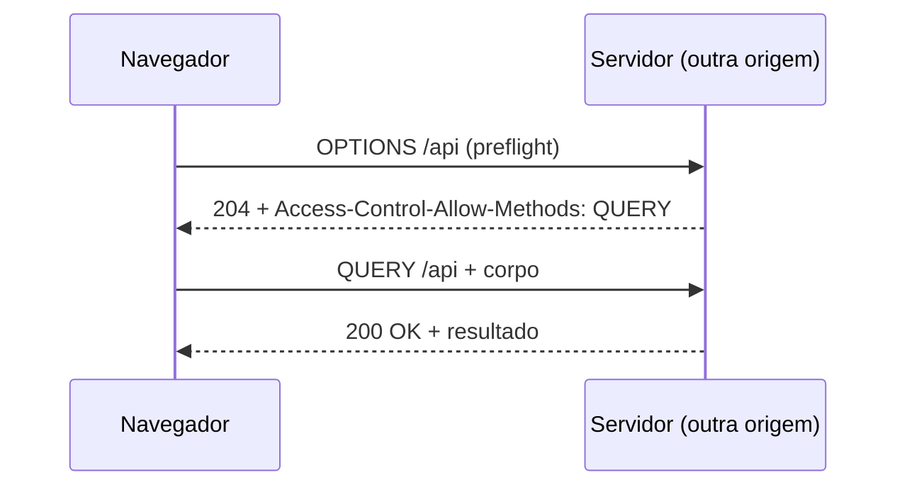
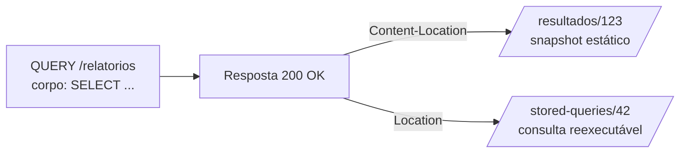
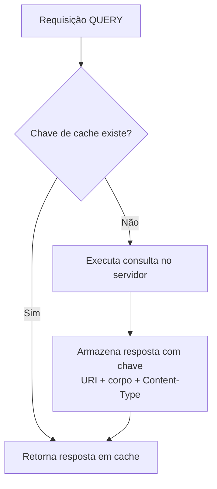
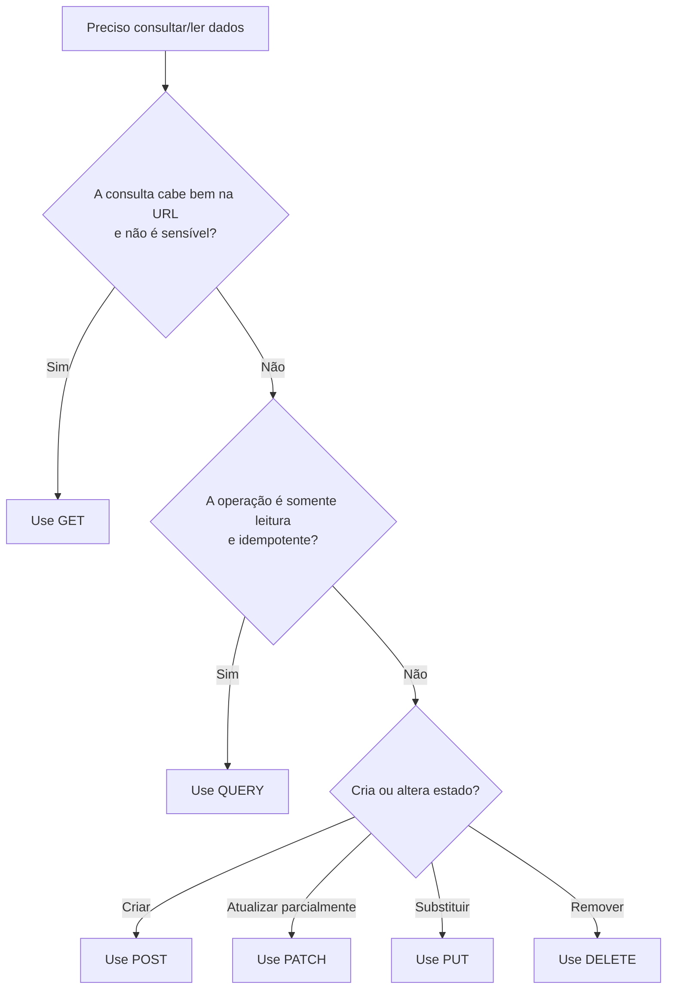
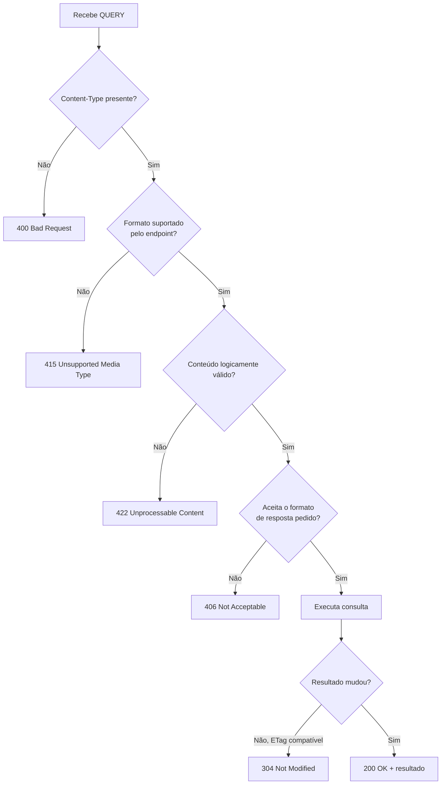
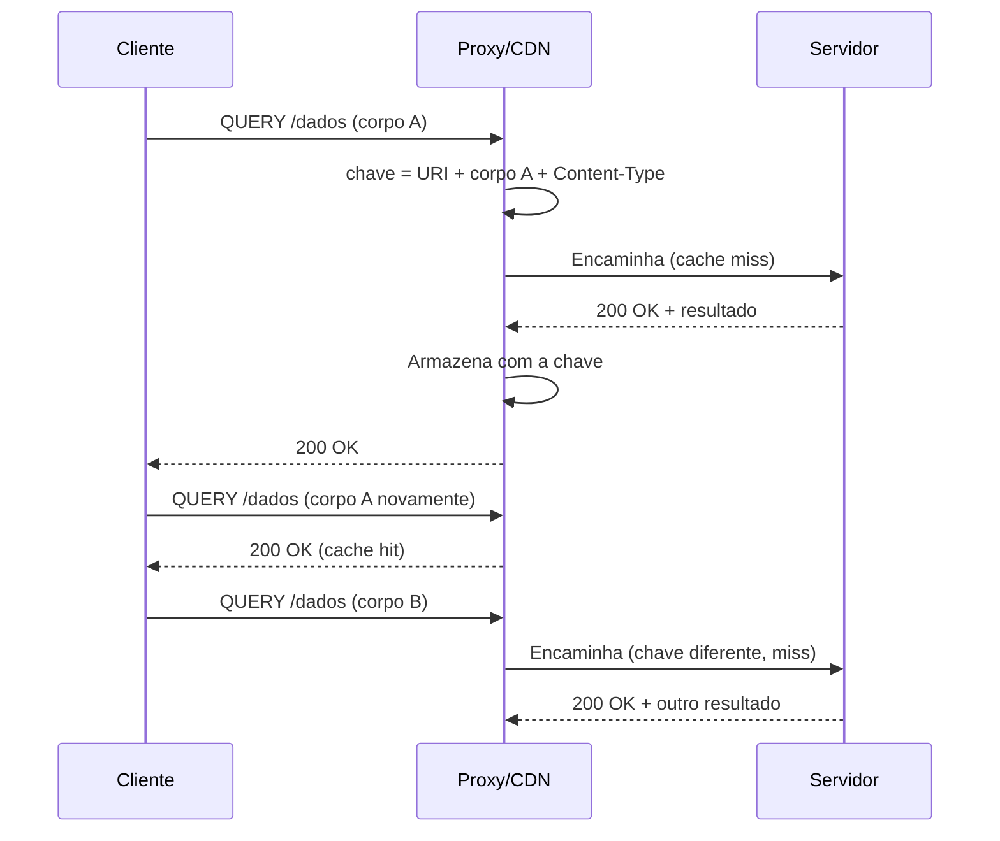

# HTTP QUERY (RFC 10008) — Material de Estudo

> **Tema:** O método HTTP `QUERY` e a evolução semântica do protocolo HTTP
> **Base:** RFC 10008 (IETF, junho de 2026) e fontes complementares
> **Nível:** Introdutório ao avançado
> **Idioma:** Português (BR)

---

## Sumário

1. [Introdução](#1-introdução)
2. [Capítulo 1 — Fundamentos e Motivação](#2-capítulo-1--fundamentos-e-motivação)
3. [Capítulo 2 — Semântica e Validação de Protocolo](#3-capítulo-2--semântica-e-validação-de-protocolo)
4. [Capítulo 3 — Arquitetura Avançada, Caching e Recursos Equivalentes](#4-capítulo-3--arquitetura-avançada-caching-e-recursos-equivalentes)
5. [Capítulo 4 — Exemplos Práticos e Aplicações Reais](#5-capítulo-4--exemplos-práticos-e-aplicações-reais)
6. [Diagramas e Ilustrações](#6-diagramas-e-ilustrações)
7. [Resumos Consolidados (Cheat Sheet)](#7-resumos-consolidados-cheat-sheet)
8. [Exercícios](#8-exercícios)
9. [Desafios Práticos](#9-desafios-práticos)
10. [Referências](#10-referências)

---

## 1. Introdução

### 1.1 Apresentação do assunto

O protocolo HTTP é a espinha dorsal da comunicação da Web. Apesar de sua onipresença, a evolução dos seus **métodos fundamentais** é extremamente rara: durante décadas, o conjunto de verbos permaneceu praticamente estável. Em **junho de 2026**, a IETF (Internet Engineering Task Force) publicou formalmente a **RFC 10008**, padronizando o **método HTTP `QUERY`**.

Trata-se do **primeiro novo verbo HTTP padronizado desde o `PATCH` (2010)** — um hiato de 16 anos sem grandes adições semânticas ao protocolo. A especificação foi elaborada por Julian Reschke, James Snell e Mike Bishop e responde a um dilema estrutural que arquitetos e desenvolvedores de APIs enfrentam há anos.

Este material explica **por que** o `QUERY` existe, **como** ele funciona na prática e **como** aplicá-lo em cenários reais, partindo dos conceitos básicos até decisões arquiteturais avançadas de caching e redirecionamento.

### 1.2 Pergunta central

> Como enviar uma consulta rica e estruturada no corpo da requisição **sem perder** as garantias de segurança, idempotência e cacheabilidade que tornam o `GET` tão poderoso?

A resposta proposta pela RFC 10008 é o método `QUERY`.

### 1.3 Objetivos de aprendizagem

Ao final deste material, você será capaz de:

- **Explicar** as propriedades semânticas de métodos HTTP: *safe*, *idempotent* e *cacheable*.
- **Comparar** `GET`, `POST` e `QUERY` quanto a tamanho de payload, privacidade, cache e reexecução.
- **Identificar** situações em que o `QUERY` é a escolha arquitetural correta.
- **Descrever** as regras de validação do `Content-Type` e os códigos de erro associados (`400`, `406`, `415`, `422`).
- **Utilizar** os mecanismos de descoberta de suporte (`Accept-Query`, `OPTIONS`, `Allow`, `405`).
- **Diferenciar** `Content-Location` (resultado estático) de `Location` (consulta reexecutável).
- **Prever** o comportamento de redirecionamentos (`301`, `302`, `303`, `307`, `308`) sobre o método e o corpo.
- **Projetar** estratégias de caching que incluam corpo e metadados na chave de cache.
- **Avaliar** o suporte do ecossistema (Node.js, cURL, Python, OpenAPI, Apidog).

### 1.4 Pré-requisitos

- Conhecimentos básicos de HTTP (requisição, resposta, cabeçalhos, códigos de status).
- Familiaridade com APIs REST e o uso de `GET`/`POST`.
- Noções de cache HTTP, CDNs e proxies (ajuda, mas não é obrigatório).

### 1.5 Como usar este material

1. **Leitura progressiva:** siga os capítulos 1 → 4 na ordem. Cada um termina com um resumo.
2. **Fixação:** resolva os exercícios do capítulo 8 após a leitura.
3. **Prática:** execute os desafios do capítulo 9 em um ambiente de testes.
4. **Consulta rápida:** use o *Cheat Sheet* (capítulo 7) como referência.
5. **Aprofundamento:** consulte a RFC 10008 e as referências do capítulo 10.

> **Nota de estudo:** este material é baseado nas fontes listadas ao final. Antes de implementar em produção, valide detalhes diretamente na especificação oficial da RFC 10008.

---

## 2. Capítulo 1 — Fundamentos e Motivação

### 2.1 O que é um método HTTP?

Um **método HTTP** é o verbo que indica a **semântica pretendida** de uma requisição. Ele não é apenas um rótulo: define o que clientes, servidores, proxies, caches e navegadores podem assumir sobre a operação. Três propriedades semânticas são centrais:

| Propriedade | Significado | Implicação prática |
|---|---|---|
| **Safe** (seguro) | A requisição é somente leitura; não altera o estado do servidor. | Pode ser pré-carregada (*prefetch*), indexada e repetida sem receio. |
| **Idempotent** (idempotente) | Repetir a mesma requisição produz o mesmo efeito observável. | Clientes e intermediários podem reexecutar automaticamente em caso de falha. |
| **Cacheable** (armazenável) | A resposta pode ser guardada e reutilizada, respeitando regras de cache. | Reduz latência e carga; habilita CDNs e proxies. |

> **Atenção:** *safe* não significa "sem corpo". Significa "sem efeito colateral de estado". O `QUERY` é a prova disso: tem corpo, mas é seguro.

### 2.2 O dilema arquitetural: GET vs POST

Tradicionalmente, recuperar e filtrar dados em APIs REST obrigava a escolher entre duas abordagens, ambas com desvantagens técnicas relevantes.

#### 2.2.1 GET com parâmetros na URL

**Vantagens:**
- Nativamente **seguro** e **idempotente**.
- Permite uso eficiente de **CDNs, proxies e caches**.
- Pode ser favoritado, compartilhado e indexado.

**Limitações:**
- Os parâmetros precisam ser codificados na **URI/URL**, impondo **limites rígidos de tamanho** em sistemas intermediários.
- **Expõe dados sensíveis** e termos de busca em logs de acesso, históricos e favoritos.
- **Dificulta filtros complexos ou aninhados** (expressões SQL, GraphQL, JSONPath).

**GET com corpo (*request body*):**
- A RFC 9110 define que o corpo em `GET` **não possui semântica definida**.
- Proxies, gateways de API e servidores intermediários podem **descartar ou rejeitar silenciosamente** o payload.
- Portanto, **não é uma solução confiável** para consultas complexas.

#### 2.2.2 POST para consultas complexas

**Vantagens:**
- Permite enviar um **corpo rico e estruturado**.
- Sem restrições de tamanho na URI.

**Limitações:**
- Por definição semântica, `POST` **não é seguro nem idempotente**.
- A infraestrutura assume que o `POST` **pode alterar o estado** do servidor.
- **Caches ignoram a resposta por padrão**.
- Clientes **não podem reexecutar automaticamente** em caso de falha de conexão, por risco de duplicar operações ou gerar efeitos colaterais.

### 2.3 O que é o método QUERY?

O `QUERY` foi projetado para preencher a lacuna entre `GET` e `POST`: oferece o **espaço do corpo do POST** aliado às **garantias semânticas do GET**.

| Propriedade | `GET` | `POST` | **`QUERY`** |
|---|---|---|---|
| Corpo com semântica definida | Não | Sim | **Sim** |
| Safe (somente leitura) | Sim | Não | **Sim** |
| Idempotente | Sim | Não | **Sim** |
| Cacheável por intermediários | Sim | Não (por padrão) | **Sim** (com chave especial) |
| Tamanho da consulta | Limitado pela URL | Sem limite prático | **Sem limite prático** |
| Privacidade em logs de URL | Baixa | Alta | **Alta** |
| Reexecução automática em falha | Sim | Não | **Sim** |

### 2.4 Anatomia de uma requisição QUERY

```http
QUERY /contacts HTTP/1.1
Host: example.org
Content-Type: application/x-www-form-urlencoded
Accept: application/json

select=surname,givenname,email&limit=10&match=%22email=*@example.*%22
```

Componentes essenciais:
- **Linha de requisição:** `QUERY <caminho> HTTP/1.1`
- **`Content-Type`:** obrigatório — define a linguagem/formato da consulta.
- **`Accept`:** define o formato de resposta desejado.
- **Corpo:** contém a consulta propriamente dita.

### 2.5 Resumo do Capítulo 1

- O `QUERY` é o primeiro novo método HTTP padrão desde o `PATCH` (2010), formalizado pela **RFC 10008** em **junho de 2026**.
- `GET` é seguro e cacheável, mas tem URL limitada, expõe dados e não suporta corpo com semântica.
- `POST` aceita corpo rico, mas não é seguro, não é idempotente e não é cacheável por padrão.
- `QUERY` **une o corpo do POST às garantias do GET**: seguro, idempotente e cacheável.

---

## 3. Capítulo 2 — Semântica e Validação de Protocolo

### 3.1 O corpo define a consulta

Diferente do `GET` — onde os metadados do corpo são desconsiderados — em uma requisição `QUERY` **o corpo é a consulta**. Por isso, a RFC 10008 define um conjunto estrito de regras para que cliente, servidor e intermediários processem a consulta com clareza semântica.

### 3.2 Obrigatoriedade do `Content-Type`

O servidor **deve rejeitar** qualquer requisição `QUERY` que:
- **não inclua** o cabeçalho `Content-Type`; ou
- tenha um **formato incompatível** com o corpo enviado.

Os servidores **não devem** tentar inferir o tipo de mídia por *content sniffing*.

### 3.3 Códigos de erro e seus significados

| Código | Nome | Quando ocorre |
|---|---|---|
| **400** | Bad Request | `Content-Type` ausente ou diferente do formato real do payload. |
| **406** | Not Acceptable | O cliente pede (via `Accept`) um formato de resposta que o servidor não consegue gerar para aquela consulta. |
| **415** | Unsupported Media Type | O formato de mídia é reconhecido, mas o recurso de destino **não suporta** essa linguagem de consulta. |
| **422** | Unprocessable Content | A sintaxe do tipo de mídia está correta, mas o **conteúdo da consulta é logicamente inviável** (ex.: SQL referenciando tabela inexistente). |

> **Regra de ouro:** `400`/`415` tratam de **formato**. `422` trata de **conteúdo logicamente inválido**. `406` trata de **negociação de resposta**.

### 3.4 Descoberta de suporte: `Accept-Query`

Foi introduzido o cabeçalho de **resposta** `Accept-Query`, que permite ao servidor divulgar quais formatos de consulta são aceitos naquele endpoint (ex.: `application/jsonpath`, `application/sql`, `application/graphql`).

```http
HTTP/1.1 200 OK
Accept-Query: "application/sql", "application/graphql"
```

O cabeçalho é estruturado sob a especificação de **Structured Fields**.

### 3.5 Descoberta via `OPTIONS`, `Allow` e `405`

Clientes podem verificar suporte de duas formas:

1. **Requisição `OPTIONS`:** o servidor anuncia o método no cabeçalho `Allow`.
   ```http
   HTTP/1.1 204 No Content
   Allow: GET, QUERY, OPTIONS, HEAD
   ```
2. **Enviar `QUERY` diretamente:** tratar uma eventual resposta `405 Method Not Allowed`.

### 3.6 Comportamento em CORS

O método `QUERY` **não faz parte dos métodos liberados (*safelisted*) no CORS**. Portanto, chamadas de origem cruzada disparadas por navegadores exigem uma **requisição de *preflight* (`OPTIONS`)** antes da requisição real.



### 3.7 Segurança semântica

O `QUERY` é **safe**: a requisição é somente leitura e não altera o estado do recurso de destino. Isso permite que:
- caches armazenem respostas;
- clientes reexecutem a consulta com segurança;
- intermediários tratem a operação como leitura.

> **Cuidado:** "safe" é uma **promessa semântica**. Um servidor mal implementado pode executar efeitos colaterais mesmo em `QUERY`. A garantia depende da implementação correta do servidor.

### 3.8 Resumo do Capítulo 2

- O corpo da requisição `QUERY` **é** a consulta; `Content-Type` é obrigatório.
- Erros: `400` (formato ausente/divergente), `415` (mídia não suportada), `422` (conteúdo inviável), `406` (resposta inaceitável).
- `Accept-Query` divulga linguagens aceitas; `OPTIONS`/`Allow`/`405` divulgam suporte ao método.
- CORS exige **preflight** para `QUERY`.
- `QUERY` é **safe** e **idempotente**.

---

## 4. Capítulo 3 — Arquitetura Avançada, Caching e Recursos Equivalentes

### 4.1 Recurso equivalente (*Equivalent Resource*)

A RFC estabelece que toda requisição `QUERY` possui conceitualmente um **recurso equivalente** que responderia a um `GET` tradicional. Esse recurso representa a **união da URI de destino com o conteúdo e os metadados do corpo da consulta**.

O servidor pode **opcionalmente** expor URIs para esse recurso equivalente na resposta, usando `Content-Location` ou `Location`.

### 4.2 `Content-Location` vs `Location`

| Cabeçalho | O que identifica | Efeito de um `GET` posterior |
|---|---|---|
| **`Content-Location`** | O **resultado específico** daquela execução de consulta. | Recupera aquele **conjunto estático** de dados armazenados (pode ser um recurso temporário). |
| **`Location`** | A **própria consulta armazenada**. | **Reexecuta** a mesma consulta sem reenviar o corpo, obtendo resultados **atualizados em tempo real**. |



### 4.3 Redirecionamentos preservados

Diferente das regras aplicadas ao `POST` — onde `301` e `302` historicamente reescrevem a requisição como `GET` — as respostas de redirecionamento abaixo **mantêm o método `QUERY` e seu corpo** na nova URI:

| Código | Nome | Comportamento com `QUERY` |
|---|---|---|
| **301** | Moved Permanently | Mantém `QUERY` + corpo |
| **302** | Found | Mantém `QUERY` + corpo |
| **307** | Temporary Redirect | Mantém `QUERY` + corpo |
| **308** | Permanent Redirect | Mantém `QUERY` + corpo |
| **303** | See Other | **Altera para `GET`** |

> **Regra prática:** `303` é o único que muda o método para `GET` (útil para apontar a um resultado armazenado).

### 4.4 Mecânica interna de caching

#### 4.4.1 Chave de cache (*cache key*)

Para armazenar respostas `QUERY` em cache, a chave **deve incorporar**:

```
cache key = URI de destino + conteúdo completo do corpo + metadados (Content-Type)
```

Sem o corpo na chave, duas consultas diferentes à mesma URI retornariam resultados errados.



#### 4.4.2 Normalização do payload

Caches podem **normalizar** pequenas diferenças no corpo para aumentar a taxa de acerto (*cache hit*), por exemplo:
- remover *content-encoding*;
- padronizar estruturas sintáticas do tipo `+json`.

Se o cliente **não quiser** transformações no cache, pode incluir a diretiva:

```http
Cache-Control: no-transform
```

#### 4.4.3 Requisições condicionais e `304`

O `QUERY` suporta validações condicionais com `If-None-Match` e `ETag`, podendo retornar `304 Not Modified` para economizar largura de banda.

```http
QUERY /relatorios HTTP/1.1
Host: example.org
Content-Type: application/sql
If-None-Match: "abc123"

SELECT * FROM rfcs WHERE decade = 2020
```

```http
HTTP/1.1 304 Not Modified
ETag: "abc123"
```

#### 4.4.4 Paginação

Em vez de usar o cabeçalho `Range` HTTP, a recomendação é usar **cláusulas nativas da linguagem de consulta**:
- SQL: `FETCH FIRST ... ROWS ONLY`
- GraphQL: argumentos de `limit`/`offset`
- JSONPath ou payloads estruturados: parâmetros de limite na própria estrutura

### 4.5 Idempotência e reexecução

Como `QUERY` é **safe** e **idempotente**, clientes podem:
- repetir automaticamente a requisição em caso de falha de conexão;
- usar lógica de *retry* sem risco de duplicar operações;
- pré-carregar resultados.

### 4.6 Resumo do Capítulo 3

- Toda `QUERY` tem um **recurso equivalente** (URI + corpo + metadados).
- `Content-Location` aponta para o **resultado estático**; `Location` aponta para a **consulta reexecutável**.
- `301`, `302`, `307`, `308` **preservam** `QUERY` e corpo; `303` muda para `GET`.
- A **chave de cache** inclui URI + corpo + `Content-Type`.
- Caches podem **normalizar** payloads; `no-transform` evita transformações.
- Suporta `ETag`/`If-None-Match`/`304` e paginação via linguagem de consulta.

---

## 5. Capítulo 4 — Exemplos Práticos e Aplicações Reais

### 5.1 Consolidação de endpoints e filtros REST complexos

Quando a quantidade de parâmetros cresce ou exige operadores complexos, a URL do `GET` fica excessivamente longa ou difícil de codificar.

**Abordagem antiga (rotas fragmentadas):**

```http
GET /api/users/active
GET /api/users/inactive
GET /api/users/premium
```

**Com HTTP QUERY (endpoint único):**

```http
QUERY /contacts HTTP/1.1
Host: example.org
Content-Type: application/x-www-form-urlencoded
Accept: application/json

select=surname,givenname,email&limit=10&match=%22email=*@example.*%22
```

O servidor responde com o resultado em JSON e `200 OK`.

### 5.2 APIs GraphQL e motores de busca (Elasticsearch)

GraphQL e Elasticsearch historicamente precisavam envelopar (*tunneling*) consultas de leitura no corpo de `POST`.

**Problema do POST:** por não ser semanticamente seguro nem idempotente, proxies, CDNs e navegadores não armazenam a resposta em cache por padrão nem reexecutam a requisição automaticamente.

**Com QUERY:**

```http
QUERY /api/graphql HTTP/1.1
Host: api.example.re
Content-Type: application/graphql

{
  users(role: "admin") {
    id
    name
    email
  }
}
```

A consulta preserva o corpo e ganha **cache e segurança nativos**.

### 5.3 Proteção de dados sensíveis e privacidade

Servidores, gateways e proxies costumam registrar a **URI inteira** (incluindo a *query string*) em logs de acesso. Se o filtro contiver dados sensíveis (e-mail, CPF, termos médicos, dados de cartão), essas informações ficam expostas nesses logs e no histórico do navegador.

**Solução com QUERY:** o corpo de uma requisição HTTP raramente é gravado em logs padrão de infraestrutura. Ao mover parâmetros sensíveis para o corpo, garante-se a privacidade mantendo a semântica de leitura segura.

> **Atenção:** isso reduz a exposição em logs de URL, mas **não substitui** criptografia (TLS) nem políticas de mascaramento de dados sensíveis. O corpo ainda pode ser registrado por ferramentas de observabilidade mal configuradas.

### 5.4 Consultas reexecutáveis e caching inteligente (`Location` e `303`)

Em relatórios pesados ou feeds de dados, o servidor pode associar a consulta a um recurso equivalente:

```http
QUERY /rfc-index.xml HTTP/1.1
Host: example.org
Content-Type: application/sql
Accept: text/csv
If-Modified-Since: Sun, 31 Aug 2025 08:44:00 GMT

SELECT * FROM rfcs WHERE decade = 2020
```

1. **Resposta com `Location`:** `200 OK` + `Location: /stored-queries/42`. O cliente pode guardar o link e executar `GET /stored-queries/42` para obter dados atualizados sem reenviar o corpo.
2. **Requisições condicionais:** se a base não mudou, o servidor responde `304 Not Modified`.
3. **Redirecionamento indireto (`303 See Other`):** o servidor aponta no `Location` para uma URI onde o resultado foi armazenado, permitindo compartilhar ou favoritar o resultado.

### 5.5 Linguagens específicas de consulta (JSONPath / XSLT)

A RFC usa o `Content-Type` para definir a linguagem de consulta. É possível enviar consultas em **JSONPath** ou **XSLT**:

```http
QUERY /errata.json HTTP/1.1
Host: example.org
Content-Type: application/jsonpath
Accept: application/json

$..[?@.errata_status_code=="Rejected" && @.submit_date>"2024"]["doc-id"]
```

O servidor valida o tipo de mídia no `Content-Type` e processa a expressão JSONPath sobre a base JSON.

### 5.6 Suporte no ecossistema atual

| Ferramenta / Plataforma | Suporte registrado |
|---|---|
| **Node.js 24** | Suporte nativo a `QUERY` no módulo `http` e na API `fetch`. |
| **cURL (8.7+)** | Aceita a flag `-X QUERY` com envio de payload via `-d`. |
| **Python 3.14** | Envia requisições `QUERY` com corpo via `http.client`. |
| **OpenAPI 3.2** | Adicionou o objeto `query` nos itens de caminho (*Path Item Object*). |
| **Apidog CLI** | Suporta definição e automação de testes com o método `"query"`. |

**Exemplos de uso:**

```bash
# cURL
curl -X QUERY https://example.org/contacts \
  -H "Content-Type: application/json" \
  -H "Accept: application/json" \
  -d '{"select":["surname","givenname"],"limit":10}'
```

```javascript
// Node.js 24 (fetch)
const res = await fetch("https://example.org/contacts", {
  method: "QUERY",
  headers: {
    "Content-Type": "application/json",
    Accept: "application/json",
  },
  body: JSON.stringify({ select: ["surname", "givenname"], limit: 10 }),
});
const data = await res.json();
```

```python
# Python 3.14 (http.client)
import http.client, json

conn = http.client.HTTPSConnection("example.org")
body = json.dumps({"select": ["surname", "givenname"], "limit": 10})
conn.request("QUERY", "/contacts", body=body, headers={
    "Content-Type": "application/json",
    "Accept": "application/json",
})
print(conn.getresponse().read())
```

### 5.7 Resumo do Capítulo 4

- `QUERY` consolida filtros complexos em um único endpoint.
- GraphQL/Elasticsearch deixam de depender semanticamente de `POST`.
- Dados sensíveis saem da URL e dos logs de acesso (com ressalvas de TLS/observabilidade).
- `Location`/`Content-Location`/`303` habilitam consultas reexecutáveis e resultados compartilháveis.
- O `Content-Type` define a linguagem (`application/sql`, `application/jsonpath`, `application/graphql`, etc.).
- Ecossistema já oferece suporte em Node.js 24, cURL 8.7+, Python 3.14, OpenAPI 3.2 e Apidog CLI.

---

## 6. Diagramas e Ilustrações

### 6.1 Árvore de decisão: qual método usar?



### 6.2 Anatomia comparada: GET vs POST vs QUERY

```
GET /busca?q=termo&limit=10            POST /busca                QUERY /busca
─────────────────────────────          ─────────────────          ─────────────────
[URL: parâmetros visíveis]             [URL: curta]               [URL: curta]
[Corpo: sem semântica]                 [Corpo: payload]           [Corpo: consulta]
Safe:        SIM                       Safe:        NÃO           Safe:        SIM
Idempotente: SIM                       Idempotente: NÃO           Idempotente: SIM
Cacheável:   SIM                       Cacheável:   NÃO*          Cacheável:   SIM*
                                     (*por padrão)              (*chave inclui corpo)
```

### 6.3 Fluxo de validação no servidor



### 6.4 Ciclo de vida do cache



### 6.5 Redirecionamentos e preservação do método

```
301 / 302 / 307 / 308  ──►  QUERY + corpo preservados
303 See Other          ──►  GET (sem corpo)
```

---

## 7. Resumos Consolidados (Cheat Sheet)

### 7.1 Em uma frase

> `QUERY` = corpo do `POST` + garantias semânticas do `GET` (safe, idempotente, cacheável).

### 7.2 Tabela-resumo de propriedades

| Aspecto | Regra |
|---|---|
| **Corpo** | Contém a consulta; semântica definida. |
| **`Content-Type`** | Obrigatório; ausência/divergência → `400`. |
| **Mídia não suportada** | `415 Unsupported Media Type`. |
| **Conteúdo inviável** | `422 Unprocessable Content`. |
| **Resposta inaceitável** | `406 Not Acceptable`. |
| **Descoberta de linguagens** | `Accept-Query` (resposta). |
| **Descoberta do método** | `OPTIONS` + `Allow` ou `405`. |
| **CORS** | Não *safelisted* → exige *preflight*. |
| **Cache key** | URI + corpo + `Content-Type`. |
| **Normalização** | Permitida; `Cache-Control: no-transform` evita. |
| **Condicional** | `ETag` + `If-None-Match` → `304`. |
| **Paginação** | Cláusulas da linguagem de consulta (não `Range`). |
| **Equivalente** | `Content-Location` (snapshot) ou `Location` (consulta). |
| **Redirecionamentos** | `301/302/307/308` preservam; `303` vira `GET`. |

### 7.3 Erros mais comuns de implementação

1. Esquecer o `Content-Type` no cliente ou ignorá-lo no servidor.
2. Usar `Range` para paginar em vez de cláusulas da linguagem.
3. Construir a chave de cache apenas com a URI (ignorando o corpo).
4. Tratar `303` como se preservasse o método.
5. Supor que `querystring` sensível está protegida só por usar HTTPS.
6. Não responder ao *preflight* CORS com `QUERY` em `Access-Control-Allow-Methods`.

---

## 8. Exercícios

### 8.1 Múltipla escolha

**1.** Qual é a principal característica que diferencia o `QUERY` do `POST`?
- a) Permitir corpo na requisição.
- b) Ser semanticamente seguro e idempotente.
- c) Ter suporte a HTTPS.
- d) Não precisar de cabeçalhos.

**2.** O que acontece se uma requisição `QUERY` não incluir `Content-Type`?
- a) O servidor infere o tipo pelo conteúdo.
- b) O servidor deve responder `400 Bad Request`.
- c) O servidor deve responder `303 See Other`.
- d) A requisição é tratada como `GET`.

**3.** Um cliente envia uma consulta SQL sintaticamente válida, mas que referencia uma tabela inexistente. Qual código é mais adequado?
- a) `400`
- b) `406`
- c) `415`
- d) `422`

**4.** Qual cabeçalho de resposta divulga as linguagens de consulta aceitas por um endpoint?
- a) `Accept`
- b) `Allow`
- c) `Accept-Query`
- d) `Content-Location`

**5.** Qual código de redirecionamento altera o método `QUERY` para `GET`?
- a) `301`
- b) `302`
- c) `303`
- d) `308`

**6.** O que deve compor a chave de cache de uma resposta `QUERY`?
- a) Apenas a URI.
- b) URI + corpo + `Content-Type`.
- c) Apenas o corpo.
- d) URI + `User-Agent`.

**7.** `Content-Location` em uma resposta `QUERY` aponta para:
- a) A consulta reexecutável.
- b) O resultado estático daquela execução.
- c) O próximo endpoint da API.
- d) O servidor de origem.

**8.** Por que o `QUERY` exige *preflight* em CORS?
- a) Porque não é um método *safelisted*.
- b) Porque não é idempotente.
- c) Porque não aceita `Accept`.
- d) Porque sempre usa cookies.

### 8.2 Verdadeiro ou falso

**9.** O `QUERY` pode ser reexecutado automaticamente em caso de falha de conexão. ( )
**10.** O corpo de uma requisição `GET` tem semântica definida pela RFC 9110. ( )
**11.** A diretiva `Cache-Control: no-transform` impede normalização do payload por caches. ( )
**12.** O `QUERY` faz parte dos métodos liberados (*safelisted*) no CORS. ( )
**13.** `Location` permite reexecutar a consulta sem reenviar o corpo. ( )
**14.** Para paginação, a recomendação é usar o cabeçalho `Range`. ( )

### 8.3 Resposta curta

**15.** Explique, em até três linhas, por que enviar corpo em `GET` não é uma solução confiável.
**16.** Descreva a diferença entre `Content-Location` e `Location`.
**17.** Cite dois riscos de privacidade do `GET` com parâmetros na URL que o `QUERY` mitiga.
**18.** O que o cabeçalho `Accept-Query` resolve e como ele complementa o `Allow`?

### 8.4 Análise de cenário

**19.** Uma equipe tem um endpoint `/relatorios` que recebe filtros muito extensos via `POST`. Os relatórios são somente leitura, pesados e se repetem com frequência. Que método deveria ser usado e por quê?

**20.** Um proxy está retornando resultados errados para consultas diferentes à mesma URI. Qual é a causa mais provável e como corrigir?

### 8.5 Gabarito

**Múltipla escolha:** 1-b · 2-b · 3-d · 4-c · 5-c · 6-b · 7-b · 8-a

**Verdadeiro/Falso:** 9-V · 10-F · 11-V · 12-F · 13-V · 14-F

**Respostas curtas (referência):**

15. A RFC 9110 não define semântica para corpo em `GET`; proxies e intermediários podem descartar ou rejeitar o payload silenciosamente.
16. `Content-Location` aponta para o resultado estático daquela execução; `Location` aponta para a consulta armazenada, que pode ser reexecutada para obter dados atualizados.
17. Exposição de dados sensíveis em logs de acesso e em históricos/favoritos do navegador; também o limite de tamanho da URL.
18. `Accept-Query` informa quais **linguagens/formats de consulta** o endpoint aceita; `Allow` informa quais **métodos HTTP** o endpoint suporta. São complementares.

**Cenários:**

19. `QUERY`: os relatórios são somente leitura (safe) e repetíveis (idempotentes), e o `QUERY` permite corpo rico com cache, ao contrário do `POST`. Se houver resultados estáveis, pode-se usar `Content-Location`/`Location` para cache e reexecução.
20. A chave de cache provavelmente considera apenas a URI. A correção é incluir o corpo completo e o `Content-Type` na chave (além de respeitar `Vary` quando aplicável).

---

## 9. Desafios Práticos

> Execute os desafios em um ambiente local ou de testes. Não aponte cargas para sistemas de terceiros sem autorização.

### Desafio 1 — Requisição básica com cURL

**Objetivo:** enviar uma `QUERY` e inspecionar a resposta.

```bash
curl -i -X QUERY https://httpbin.org/anything \
  -H "Content-Type: application/json" \
  -H "Accept: application/json" \
  -d '{"select":["id","name"],"limit":5}'
```

**Tarefas:**
1. Verifique se o método e o corpo chegam ao servidor.
2. Altere o `Content-Type` para um valor incorreto e observe o comportamento.
3. Remova o `Content-Type` e registre a resposta.

### Desafio 2 — Servidor mínimo com Node.js 24

**Objetivo:** implementar um endpoint `QUERY` que valide `Content-Type` e responda com `Accept-Query`.

**Tarefas:**
1. Crie um servidor que aceite `QUERY` em `/contacts`.
2. Responda `Accept-Query: "application/json", "application/jsonpath"`.
3. Retorne `400` se `Content-Type` estiver ausente.
4. Retorne `415` para mídia não suportada.
5. Retorne `422` para payload JSON inválido.
6. Retorne `200` com dados filtrados para payload válido.

**Critérios de aceite:**
- `OPTIONS /contacts` retorna `Allow: GET, QUERY, OPTIONS`.
- Requisições inválidas retornam os códigos corretos.
- Requisições válidas retornam JSON.

### Desafio 3 — Caching com chave composta

**Objetivo:** simular um cache que diferencia consultas pelo corpo.

**Tarefas:**
1. Implemente um cache em memória cuja chave seja `URI + hash(corpo) + Content-Type`.
2. Envie duas consultas diferentes à mesma URI e confirme que os resultados não se misturam.
3. Envie a mesma consulta duas vezes e confirme o *cache hit*.
4. Adicione suporte a `ETag` e `If-None-Match`, retornando `304` quando aplicável.

### Desafio 4 — Redirecionamentos

**Objetivo:** comparar `303` com `307`.

**Tarefas:**
1. Configure um endpoint que responda `303 See Other` para `/resultado`.
2. Configure outro que responda `307 Temporary Redirect` para `/resultado`.
3. Envie `QUERY` para ambos e registre qual preserva o método e o corpo.

### Desafio 5 — Privacidade em logs

**Objetivo:** comparar exposição de dados entre `GET` e `QUERY`.

**Tarefas:**
1. Faça um `GET /busca?email=fulano@example.com`.
2. Faça uma `QUERY /busca` com o e-mail no corpo.
3. Inspecione os logs de acesso do servidor e identifique o que aparece em cada caso.
4. Proponha uma política de mascaramento para o que ainda puder ser registrado.

### Desafio 6 — Consulta em JSONPath

**Objetivo:** usar `application/jsonpath`.

**Tarefas:**
1. Disponibilize um JSON de exemplo com uma lista de documentos.
2. Aceite `QUERY` com `Content-Type: application/jsonpath`.
3. Filtre, por exemplo, documentos com `status == "Rejected"`.
4. Retorne `422` para expressões JSONPath inválidas.

### Desafio 7 — Integração com OpenAPI 3.2

**Objetivo:** documentar o endpoint usando o objeto `query`.

**Tarefas:**
1. Escreva um fragmento OpenAPI 3.2 para `QUERY /contacts`.
2. Declare `requestBody` com `application/json` e `application/jsonpath`.
3. Documente as respostas `200`, `400`, `406`, `415` e `422`.
4. Valide o documento com uma ferramenta de lint de OpenAPI.

---

## 10. Referências

### 10.1 Especificação oficial

- **RFC 10008 — The HTTP QUERY Method (RFC Editor)** — especificação técnica oficial do método `QUERY` publicada pela IETF.
  <https://www.rfc-editor.org/info/rfc10008>
- **RFC 9110 — HTTP Semantics** — define semântica de métodos, incluindo a ausência de semântica de corpo em `GET`.

### 10.2 Artigos e análises

- **InfoQ — "IETF Publishes RFC 10008, Adding the QUERY Method for Safe Requests with a Body"** — análise do lançamento e do impacto na arquitetura de software.
  <https://www.infoq.com/news/2026/09/http-query-method/>
- **Apidog — "Método HTTP QUERY explicado: RFC 10008, QUERY vs GET vs POST"** — comparativo em português sobre segurança, idempotência e suporte em ferramentas.
  <https://apidog.com/pt/blog/http-query-method/>
- **http.dev — "QUERY — Expert Guide to HTTP methods"** — guia técnico sobre validação de cabeçalhos (`Accept-Query`), redirecionamentos e CORS.
  <https://http.dev/query>
- **DEV Community — "The new HTTP method: QUERY"** — artigo focado no ecossistema backend e na semântica de URLs para consultas salvas.
  <https://dev.to/tykok/the-new-http-method-query-2bec>

### 10.3 Leitura complementar recomendada

- Documentação de **Structured Fields** (RFC 8941) — base do cabeçalho `Accept-Query`.
- Documentação de **CORS** (Fetch Living Standard / MDN) — *preflight* e métodos *safelisted*.
- Documentação de **HTTP Caching** (RFC 9111) — chaves de cache, `Vary`, `no-transform`.
- Documentação de **OpenAPI 3.2** — objeto `query` em *Path Item Object*.

---

### Nota final

Este material é um guia de estudo. Sempre confirme detalhes de implementação, códigos de erro e comportamento de intermediários na **RFC 10008** e nas especificações correlatas antes de levar o `QUERY` para produção.
